# FreakyMate

**A touch screen for Klipper, with Happy Hare and Spoolman built in.**

A touch screen interface for 3D printers running [Klipper](https://www.klipper3d.org/): a small native app that runs
on the printer's own host (Raspberry Pi, BTT CB1/CB2 and similar), fills the display attached to it and talks to
[Moonraker](https://moonraker.readthedocs.io/). It has built-in support for **[Happy Hare](https://github.com/moggieuk/Happy-Hare)
(MMU)** and **[Spoolman](https://github.com/Donkie/Spoolman)**.

Written in Rust with a [Slint](https://slint.dev/) UI: no browser, no WebView, no X11 desktop needed. The first target
is the BTT HDMI5 (5", 800x480, landscape).

> [!CAUTION]
> **Early development, tried by one person only. Not intended for productive use.**
> So far I have run it against the included fake Moonraker, on desktops and on a BTT HDMI5, and read the data of one
> real printer; most functions have not been tried on a real machine. It sends commands that move motors, heat up nozzles and beds and restart
> services; a bug can damage your printer, your print or start a fire. Use it only if you know what you are doing, never
> leave the printer unattended, and keep an emergency stop within reach.
> The software is provided "as is", **without any warranty and without any liability** of the author
> for damage of any kind, to the extent permitted by law (see sections 15 and 16 of the [GPL](LICENSE)).

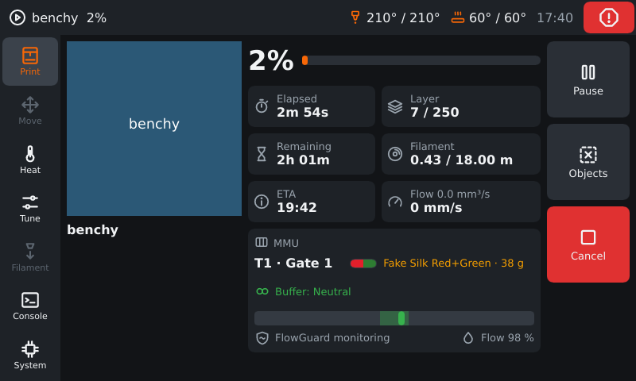

|                                      |                                        |                                                            |
| ------------------------------------ | -------------------------------------- | ---------------------------------------------------------- |
| 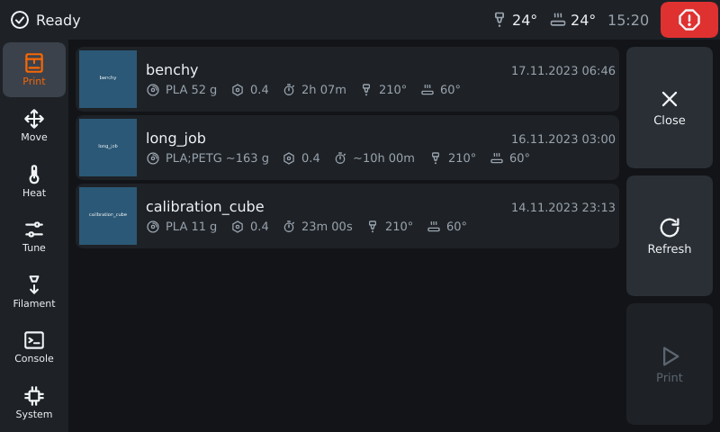 | 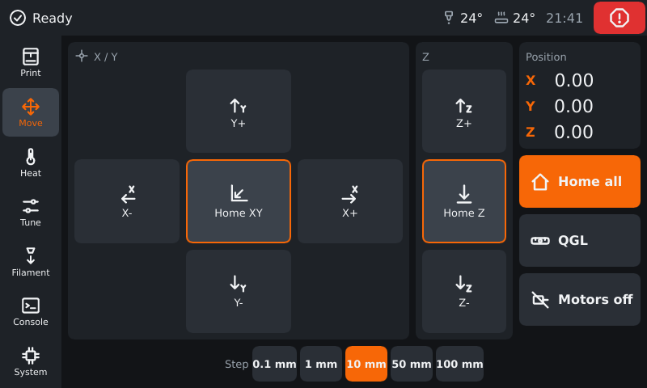     | 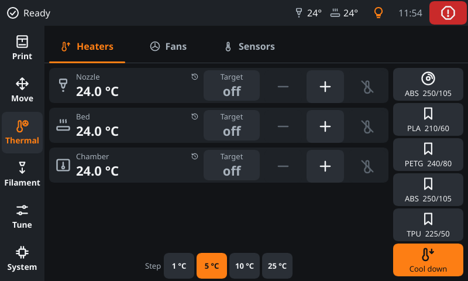           |
| 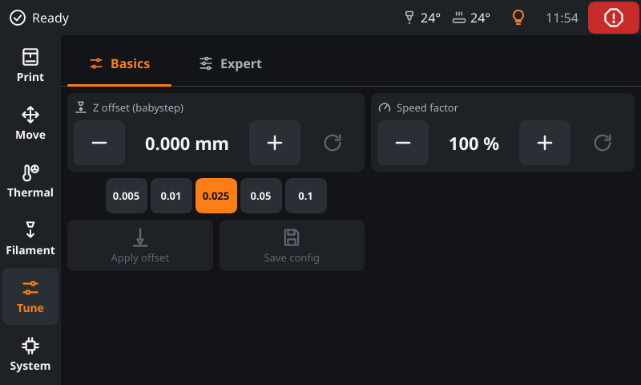   | 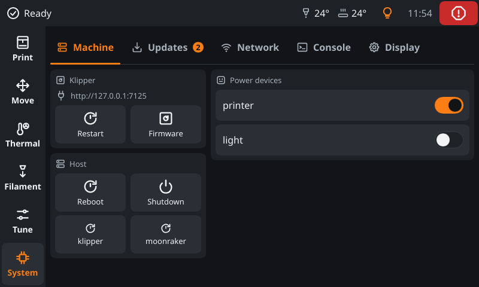 | 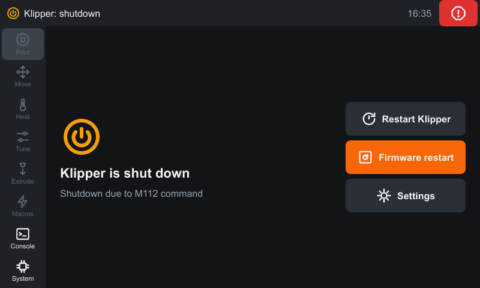 |
| 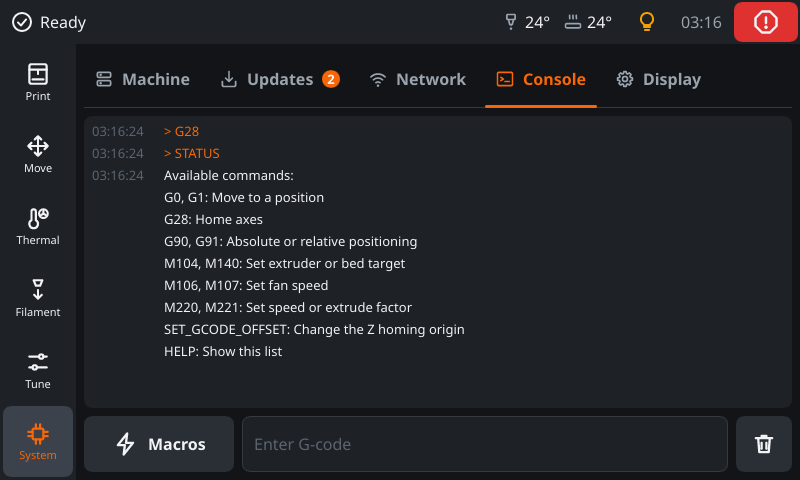 | 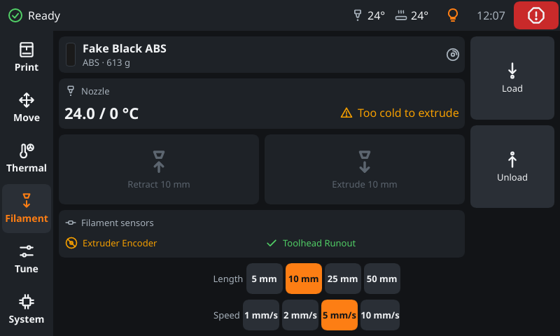 | 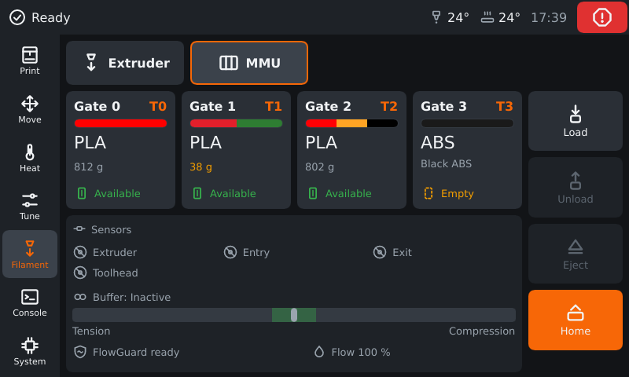       |

## Features

- **Print**: thumbnail, progress, elapsed/remaining/ETA, layers, filament; start, pause, resume, cancel, exclude objects (on a map of the bed if the slicer defines their outlines);
  file browser with thumbnails, filament, nozzle and print time of each file.
- **Move**: jog X/Y/Z with selectable steps, home (all/XY/Z), motors off, Quad Gantry Level or Z-Tilt when configured.
- **Thermal**: every heater with a target (nozzle, bed, `heater_generic`, `temperature_fan`), presets; − and +
  respect `min_temp`/`max_temp` from the Klipper configuration. Tapping a heater or sensor shows its temperature
  history with a grid: the last 20 minutes of Moonraker's temperature store, asked again every five seconds while it
  is open. Moonraker keeps heaters and `temperature_sensor` objects there; the others have no history. Further tabs when the printer has them:
  - **Fans**: part fan and `fan_generic` fans (filter, exhaust) with a slider, `heater_fan` and `controller_fan` as a
    bar, speed in rpm where there is a tachometer.
  - **Sensors**: every temperature without a target (`temperature_sensor` of any sensor type, TMC2240 drivers).
- **Light**: the light symbol in the status bar opens a panel with the main (chamber) light as a switch, every LED
  (`neopixel`, `led`, `dotstar`, …) on, off and dimmed as white light, and the effects of the
  [led_effect](https://github.com/julianschill/klipper-led_effect) plugin when it is installed.
- **Tune**: what one corrects while watching a print: Z offset (babysteps, apply to probe/endstop, save config) and
  the speed factor, with a quiet note that layer times then differ from the slicer's plan. The **Expert** tab holds
  the calibration values until the next restart: flow factor, pressure advance and smooth time, velocity and
  acceleration limits, square corner velocity, minimum cruise ratio and firmware retraction; it shows where a value
  differs from the configuration and resets it.
- **Filament**: extrude/retract with length and speed (lengths up to `max_extrude_only_distance`), `LOAD_FILAMENT`/`UNLOAD_FILAMENT` macros when present, filament sensors.
- **System**, in five tabs:
  - **Machine**: Klipper/firmware restart, host reboot/shutdown, service restart, power devices.
  - **Updates**: Moonraker's update manager; the tab shows how many updates are waiting.
  - **Network**: Wi-Fi and Ethernet (see [Network settings](#network-settings)).
  - **Console** (also from the message flyout): G-code history and live responses, a command field (on-screen keyboard
    or physical keyboard), and an expandable list of macros. Like Mainsail it hides the temperature reports Klipper
    sends while waiting for a heater (can be turned off). Macros starting with `_` and macros that rename a built-in
    command (`rename_existing`) are hidden; further macros can be hidden on the Display tab. Macros with parameters
    open a form first: each parameter is read from the macro's template, Klipper defaults show as placeholders in
    brackets.
  - **Display**: Moonraker address, fullscreen, the console filter and which macros the console offers. Temperature
    presets are set in the [settings file](#settings-file).

Functions only appear when the printer has them (capabilities from `printer.objects.list` and `server.info`).

### Happy Hare (MMU)

Needs Happy Hare 4.1 or newer. The **MMU** tab on the Filament page and a strip on the print page show:

- the gates (four at a time): status, material, colour and mapped tool; load, unload, eject and home the selected gate,
  recover and unlock after a pause;
- the way of the filament of the selected gate, from the gate through the bowden and the extruder to the nozzle,
  filled in the colours of the spool as far as Happy Hare reports it (`filament_pos`), with the sensors on the way,
  the direction and the distance; on the print page as a slim line;
- the other MMU sensors, the sync-feedback buffer (tension, neutral, compression) and the FlowGuard state: ready, monitoring,
  tangle prevention at work, or triggered with its reason;
- the flow rate, measured by the encoder or estimated by the sync-feedback controller with a proportional sensor.

|  | 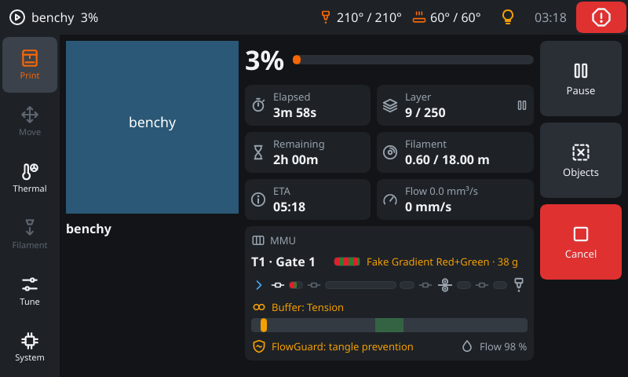 |
| ------------------------------------ | ------------------------------------------------------------------------------------------------------ |
| The MMU tab: gates, sensors, buffer  | The print page while tangle prevention raises the gear current (the FlowGuard line turns yellow)       |

### Spoolman

Appears when Moonraker has the `spoolman` component, with or without an MMU:

- the spool in use and what is left of it on the print page and at each gate, with a colour bar for multi-colour
  filaments: side by side for coaxial ones (silk), taking turns for longitudinal ones (gradient);
- a picker lists the spools (the ones in a gate first, then the most recently used): assign a spool to a gate or, without
  an MMU, choose the active spool, and correct the remaining weight by weighing;
- the temperature page offers a preset for the spool in use and notes quietly when the target is off from it;
- before a print the confirmation names what differs between the file and the spools (material, weight, colour), only as
  a hint.

| 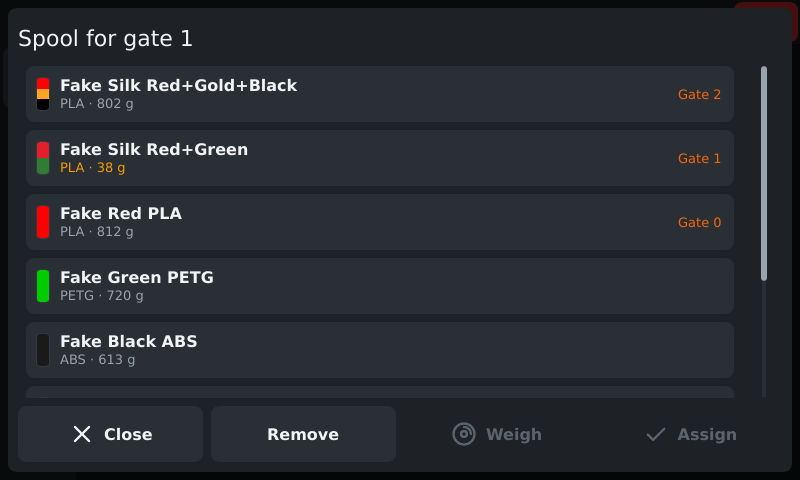 | 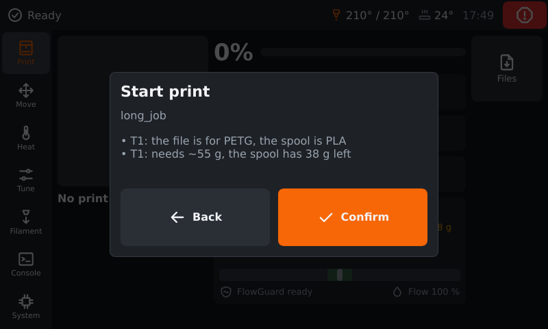 | 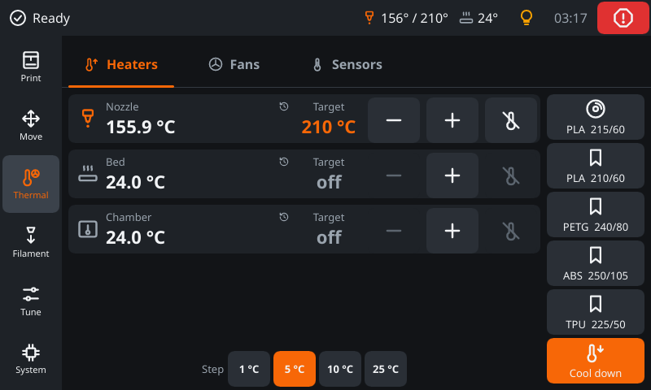 |
| -------------------------------------------------- | ----------------------------------------------------------- | ------------------------------------------------------------------------------- |
| Spools with colour, material and weight left       | Before a print: what differs between file and spools        | The first preset on the temperature page belongs to the spool in use            |

## How it compares to KlipperScreen

[KlipperScreen](https://github.com/KlipperScreen/KlipperScreen) is the established touch screen UI for Klipper, with a
large community, many panels and a much wider hardware support. **If you want something proven, use KlipperScreen.**
FreakyMate is a younger, smaller alternative with a different technical approach and with Happy Hare and Spoolman
built in. This is what I found in the KlipperScreen documentation (read in October 2026) and in my own project:

|                      | KlipperScreen                                                                                                    | FreakyMate                                                                                          |
| -------------------- | ---------------------------------------------------------------------------------------------------------------- | ------------------------------------------------------------------------------------------------------ |
| Maturity             | Since 2020, active community, translations on Weblate, sponsored by LDO and YUMI                                 | Early development, one person, English only                                                           |
| Technology           | Python with GTK; X11 (default) or a Wayland compositor such as Cage or Weston                                    | Rust with Slint, one native binary; fullscreen under `cage` (Wayland) or as a normal window            |
| Scope                | Many panels, among them bed mesh, bed level screws, input shaper, Z calibrate, limits, retraction, power         | The everyday ones: print, move, heat, tune, filament, console, macros, system, settings, network       |
| Printers and hosts   | Several printers from one screen; can run on another device than the printer host                                | One Moonraker; can connect to a remote one, Wi-Fi settings need the printer host                       |
| Displays             | Many, including GPIO/SPI displays                                                                                | BTT HDMI5 (800x480) first, other sizes are scaled, no SPI displays                                     |
| Spoolman             | Has a Spoolman panel                                                                                             | Woven into the print page, the temperature page and the MMU gates, with hints before a print           |
| Happy Hare           | Separate fork, [KlipperScreen Happy Hare Edition](https://github.com/moggieuk/KlipperScreen-Happy-Hare-Edition), installed in place of KlipperScreen | Built in, needs Happy Hare 4.1 or newer; buffer, FlowGuard and flow rate included |
| Updates              | Moonraker update manager or KIAUH                                                                                | Moonraker update manager with `stable` and `beta` channels                                              |
| License              | AGPL-3.0                                                                                                         | GPL-3.0-or-later                                                                                       |

I did not look into what the KlipperScreen Spoolman panel can do beyond its existence, so this row says nothing about
the depth of either.

## Install on the printer host

This is the main use case: FreakyMate runs on the host of the printer (Raspberry Pi OS, Armbian or another
Debian-based system with the display attached), starts fullscreen on the display at boot and updates itself through
Moonraker's update manager, like Mainsail or Fluidd.

1. Download the zip for your system from the [releases](https://github.com/freakydude/freakymate/releases):
   `aarch64-unknown-linux-gnu` (64-bit Raspberry Pi OS/Armbian, CB1/CB2), `armv7-unknown-linux-gnueabihf` (32-bit), `x86_64-unknown-linux-gnu`.
   Builds target Debian Bookworm and run on Bookworm and Trixie.
2. Unpack and run the installer as your normal user (the one running Klipper and Moonraker):

   ```bash
   unzip freakymate-aarch64-unknown-linux-gnu.zip -d freakymate-setup
   cd freakymate-setup && ./install.sh -m http://127.0.0.1:7125
   ```

   The installer
   - installs the packages from `system-dependencies.json` (among them `cage`, a minimal Wayland kiosk compositor),
   - copies the program to `~/freakymate` and creates the systemd service `freakymate` (fullscreen on `tty1`),
   - registers it with Moonraker's update manager (`[update_manager freakymate]` in `moonraker.conf`, service in
     `moonraker.asvc`) and restarts Moonraker.

   Options: `-m <moonraker url>`, `-d <printer_data folder>` (default `~/printer_data`), `-c stable|beta` (update channel, see below).
   Settings go to `printer_data/config/freakymate.json`, next to the Klipper configs, as KlipperScreen does with its
   `KlipperScreen.conf`. An existing `~/.config/freakymate/settings.json` is copied there once.
   Remove everything with `~/freakymate/uninstall.sh`; the settings file stays.

### Updates and channels

After the installation FreakyMate shows up in the update list of Mainsail, Fluidd and its own System page.
Moonraker downloads the matching zip from the GitHub releases, replaces `~/freakymate` and restarts the service.
The section written by the installer (add it yourself if `moonraker.conf` lives elsewhere):

```ini
[update_manager freakymate]
type: zip
channel: stable          # beta = also preview builds of main
repo: freakydude/freakymate
path: ~/freakymate
managed_services: freakymate
system_dependencies: system-dependencies.json
```

| Channel  | What you get                                                                                                                        |
| -------- | ----------------------------------------------------------------------------------------------------------------------------------- |
| `stable` | Releases `vX.Y.0` that I publish by hand when a set of changes feels finished. Few updates, the safer choice.                       |
| `beta`   | In addition a preview build of **every** change on `main` (`vX.Y.Z`, replaced by the next one). New things first, may be broken.    |

To change the channel set `channel:` in that section and restart Moonraker (`sudo systemctl restart moonraker`). The
installer only writes the section once: re-running `install.sh` with `-c beta` does not change an existing `channel`
line, so edit it by hand. Your edits survive later updates, because Moonraker only replaces the program folder.

## Packages and desktop use

Besides the Moonraker route there are plain packages, for example to try it on a desktop or any other device:

- **Debian package**: each release contains `freakymate_<version>_<arch>.deb` (`amd64`, `arm64`, `armhf`). apt installs
  the dependencies and removes the package cleanly, but Moonraker does **not** update it, install newer `.deb` files
  yourself. Use either the zip installer or the package, not both (they would compete for `tty1`).

  ```bash
  sudo apt install ./freakymate_0.2.0_arm64.deb
  sudo systemctl disable getty@tty1                # free tty1 for the kiosk
  sudo systemctl enable --now freakymate@$USER  # fullscreen on tty1 as this user
  # remove again (stops and disables all freakymate@ instances)
  sudo apt remove freakymate && sudo systemctl enable getty@tty1
  ```

- **Windowed mode on a desktop** (Linux PC, Raspberry Pi OS with desktop, Windows): the program opens as a normal window
  and talks to any Moonraker over the network. On Debian and Ubuntu install the `.deb` and start `freakymate` from a
  terminal (skip the `systemctl` lines above, they set up the kiosk); on Windows unpack
  `freakymate-x86_64-pc-windows-msvc.zip` and run `freakymate.exe`. There is no Windows installer yet. Set the
  Moonraker address on System → Display or with `-m` (default `http://127.0.0.1:7125`); `-f` starts it fullscreen.

## Configuration

### Command line

```text
freakymate [--moonraker <url>] [--fullscreen] [--settings <file>] [--simulate-network]
```

| Option               | Meaning                                                                                          |
| -------------------- | ------------------------------------------------------------------------------------------------ |
| `-m, --moonraker`    | Moonraker address for this start, e.g. `http://printer.local:7125` (otherwise the saved setting) |
| `-f, --fullscreen`   | Fullscreen/kiosk mode                                                                            |
| `--settings`         | Settings file, default `~/.config/freakymate/settings.json` (Windows: `%APPDATA%`). The installer passes `printer_data/config/freakymate.json` |
| `--simulate-network` | Simulated Wi-Fi/Ethernet instead of NetworkManager (development builds only, see below)          |

Useful environment variables: `RUST_LOG=debug` (logging), `SLINT_BACKEND=winit-software` (force software rendering if the GPU
driver causes trouble), `SLINT_SCALE_FACTOR=1.5` (sets the scale by hand and turns the fitting to the display off).
Without a desktop or compositor the optional cargo feature `linuxkms` renders directly via DRM/KMS (experimental in Slint).

### Settings file

FreakyMate keeps its settings in a JSON file: `printer_data/config/freakymate.json` when installed with the installer
(so it can be edited in Mainsail or Fluidd next to the Klipper configs), otherwise `~/.config/freakymate/settings.json`
(Windows: `%APPDATA%\freakymate\settings.json`). The file is created with the defaults at the first start. Most entries are
changed on the screen; the **temperature presets** only here:

```json
"temperature_presets": [
  { "name": "PLA", "extruder": 210.0, "bed": 60.0 },
  { "name": "PETG", "extruder": 240.0, "bed": 80.0 },
  { "name": "ABS", "extruder": 250.0, "bed": 105.0 },
  { "name": "TPU", "extruder": 225.0, "bed": 50.0 }
]
```

The Thermal page shows the first four. Restart FreakyMate after editing (`sudo systemctl restart freakymate`); it
writes the file itself when a setting changes on the screen, so edit it while FreakyMate is stopped or restart right
after saving.

### Displays

The supported display is the BTT HDMI5 (800x480), where it has been run; the layout is made for it. Other resolutions show the same layout
scaled up or down to fit, so a 7" 1024x600 display fills its screen and a 4.3" 480x272 display shows everything, only
smaller. These are not tested yet. A 3.5" 480x320 display is too small to operate comfortably, and displays that hang on
the SPI bus may not work with the kiosk compositor at all. Layouts of their own for the 7" and 4.3" displays are planned.

### Network settings

Moonraker can only report the host's network (`machine.system_info`), it cannot change it. FreakyMate therefore talks
to NetworkManager over D-Bus, like KlipperScreen. Managing Wi-Fi (open, WPA/WPA2, WPA3, hidden, remove saved networks,
on/off) and Ethernet (status, connect/disconnect) is offered when

- FreakyMate runs on Linux with NetworkManager (default on Raspberry Pi OS Bookworm and newer), and
- Moonraker runs on the same host (`localhost`/`127.0.0.1`), so the changed network is the printer's network.

The user needs the polkit rule `50-freakymate.rules` (allows the NetworkManager actions for the group `netdev`).
`install.sh` installs it to `/etc/polkit-1/rules.d` and adds the user to `netdev`; the Debian package ships it in
`/usr/share/polkit-1/rules.d`, add the user yourself: `sudo usermod -aG netdev $USER` (takes effect after re-login or a
service restart). Changing the network while printing asks for confirmation, because the connection may drop.

On Windows, on Linux without NetworkManager or with a remote Moonraker the section only shows the printer host's
interfaces and addresses read from Moonraker.

## Development

Rust stable (see `rust-toolchain.toml`). On Linux install `libfontconfig1-dev libxkbcommon-dev`.
For Windows without admin rights (setup, faster linking with `rust-lld`, build times) see
[docs/windows-without-admin.md](docs/windows-without-admin.md). Structure, data flow and conventions:
[docs/architecture.md](docs/architecture.md); workflows and use cases: `docs/UseCases and Dependencies.drawio`.

### Try it without a printer

The `fake-moonraker` crate is a simulated Moonraker/Klipper (WebSocket JSON-RPC, files, thumbnails, heaters, a print job
that progresses). It listens on `127.0.0.1` only.

```bash
cargo run -p fake-moonraker -- --profile voron --port 7125 --time-scale 10   # the simulated printer
cargo run -p freakymate -- -m http://127.0.0.1:7125                       # the app, in a window
```

| Fake option    | Meaning                                                                          |
| -------------- | -------------------------------------------------------------------------------- |
| `--profile`    | `basic`, `voron` (default) or `happy-hare`, see below                            |
| `--gates`      | number of MMU gates, 1 to 16 (default 4; only with `happy-hare`)                 |
| `--port`       | port to listen on (default 7125; only one fake can run per port)                 |
| `--time-scale` | simulation speed (default 10): heating and printing run that many times faster   |

| Profile      | Simulates                                                                                                                  |
| ------------ | -------------------------------------------------------------------------------------------------------------------------- |
| `basic`      | a plain printer: nozzle, bed, fans, no optional modules                                                                    |
| `voron`      | adds Quad Gantry Level, a chamber heater, filament sensors, `exclude_object` and Spoolman                                  |
| `happy-hare` | adds a Happy Hare MMU with a proportional sync-feedback buffer and FlowGuard, spools in the gates, and Spoolman            |

`FAKE_MMU_TANGLE BOOST=1` (G-code, simulator only) lets tangle prevention boost the gear current during a print. In VS Code
the tasks and debug configurations "run: fake-moonraker", "run: freakymate (fake Moonraker)" and their Happy Hare
variants start both. The app also takes `--simulate-network` in development builds to try the Wi-Fi settings without
NetworkManager.

### Checks, screenshots and previews

```bash
cargo fmt --all
cargo clippy --workspace --all-targets -- -D warnings
cargo test --workspace
scripts/verify.sh [--snapshot]                           # WSL2/Arch: all of the above plus previews and the skill check in one go
scripts/ui-preview.sh                                    # renders crates/app/ui/preview/*.slint with sample data in seconds
scripts/ui-snapshot.sh [-p happy-hare] [-s 1024x600] [-F] [-S pages,printing]   # starts the fake itself, renders the screens to PNG
cargo run -p ui-snapshot -- --out shots --scenes all     # the same by hand (needs the fake running)
cargo run -p icon-index                                  # after changing icons in assets/icons
```

`ui-snapshot` runs the real UI headless against the fake and writes one PNG per screen (`-p` picks the fake profile,
`-s` the window size, `-F` switches the fitting to the display off, `-S` chooses scenes: `pages`, `spools`, `network`,
`taps`, `typing`, `printing`, `shutdown`, `idle`). `ui-preview` renders single `.slint` files with fixed sample data, no build needed.

Scripts exist in two variants with the same behaviour:

- `scripts/*.sh` (bash) for WSL2 with Arch Linux, the main development environment. `scripts/setup-wsl.sh` checks the environment.
- `scripts/*.ps1` (PowerShell) for Windows without admin rights. `scripts\setup.ps1` prepares the GNU toolchain there, see [docs/windows-without-admin.md](docs/windows-without-admin.md).

### Tools

| Tool                                                                                   | Needed for                                      | How to get it                                                                                                           | Where it is looked up                                                                  |
| -------------------------------------------------------------------------------------- | ----------------------------------------------- | ----------------------------------------------------------------------------------------------------------------------- | -------------------------------------------------------------------------------------- |
| Rust (`rustup`)                                                                        | everything                                      | [rustup.rs](https://rustup.rs); `rust-toolchain.toml` selects the version                                               | `PATH`                                                                                 |
| MinGW linker ([w64devkit](https://github.com/skeeto/w64devkit))                        | building on Windows without MSVC                | `scripts\setup.ps1` downloads it                                                                                        | `%USERPROFILE%\tools\w64devkit\bin`, added to the user `PATH` by the script            |
| [`slint-viewer`](https://docs.slint.dev/latest/docs/slint/guide/tooling/slint-viewer/) | `scripts/ui-preview.sh` (WSL2), `scripts\ui-preview.ps1` (Windows) | WSL2: the script compiles the version matching `slint` in `Cargo.lock` into `~/.local/bin` (`cargo install slint-viewer --version <same>`); Windows: the script downloads it | `slint-viewer` on `PATH` first, otherwise the script's install location |
| Slint extension for VS Code (optional)                                                 | live preview of `crates/app/ui/preview/*.slint` | VS Code marketplace (`Slint.slint`)                                                                                     | –                                                                                      |

To use your own `slint-viewer`, put it on `PATH`; it should have the same version as the `slint` crate.

### Development builds and releases

Local builds of `freakymate` include the cargo feature `dev-mode` (default): the option `--simulate-network`
and the simulated networks in the core. Releases are built with `--no-default-features` and contain none of it.
The development tools are separate programs and never shipped: `fake-moonraker` (simulated printer) and
`ui-snapshot` (screenshots of the UI).

### Contributing

`main` is protected: changes go through a pull request, all CI checks must be green and the code owner
(`.github/CODEOWNERS`) has to approve it. This is a hobby project, so replies may take a while.

### CI, versions and releases

- Versions come from git tags (`.github/scripts/version.sh`): releases are `vX.Y.0`, every later commit on `main` adds
  one to the patch number (`0.2.1`, `0.2.2`, ...). Pull request builds are `X.Y.Z-pr.<number>.<run>`, other branches
  `X.Y.Z-dev.<commit>`, local builds `0.0.0-dev`. The version is shown on the Settings page and by `--version`.
- Every push and pull request: format, clippy, tests, builds and packages for all targets (`.github/workflows/ci.yml`),
  with cargo caching. The packages are attached to the run as artifact `packages-<version>`; pull requests get a
  comment with the download link, so an open pull request can be tried before it is merged.
- Every push to `main` is published as prerelease `vX.Y.Z`, replacing the previous prerelease. Moonraker offers it on
  the `beta` channel.
- Release: run the workflow **Release** (Actions tab) on `main` and choose `minor` or `major`. It tags `vX.Y.0`,
  builds and publishes the release with generated notes; Moonraker offers it on the `stable` channel. The patch number
  then starts again at 0.
- Assets: one zip per target and one `.deb` per Linux target (`.github/scripts/build-deb.sh`, files in
  `scripts/debian`). Linux zips contain `freakymate`, `install.sh`, `uninstall.sh`,
  `system-dependencies.json` and `release_info.json` (version and asset name for Moonraker); Windows: `freakymate.exe`.

## Contact and support

Want to get in touch, report a bug, discuss a feature or show what you built? Meet me and the others who try
FreakyMate on Discord. Bugs and feature requests are also welcome as GitHub issues, and pull requests too (see
[Contributing](#contributing)).

<a href="https://discord.gg/Ja2cxCcmJQ"></a>

FreakyMate is a private project that I work on in my spare time, for my own printer. It comes without support
promises, so answers may take a while. If you like it and want to say thanks, you can support me here:

<a href="https://ko-fi.com/freakydude"></a>
<a href="https://www.patreon.com/freakydude"></a>
<a href="https://www.buymeacoffee.com/freakydude"></a>

## License

GPL-3.0-or-later, see [LICENSE](LICENSE). Slint is used under its GPLv3 option.
