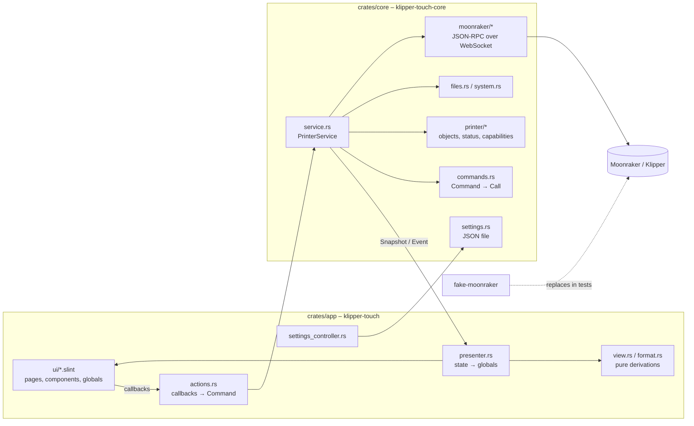

# Architecture

Goal: a lean, native touch UI for Klipper that runs directly on the printer host. The operator's workflows shape the UI
(see `docs/UseCases and Dependencies.drawio`, page "Workflows"); the printer's capabilities only decide whether a step is
offered.

## Building blocks

| Crate | Responsibility | Depends on |
| --- | --- | --- |
| `crates/core` | Connection, protocol, printer state, capabilities, commands, settings. No UI code. | tokio, tokio-tungstenite, reqwest, serde |
| `crates/app` | Slint UI and its binding to the core; binary `klipper-touch`, tool `ui-snapshot`. | core, slint |
| `crates/icon-index` | Checks `assets/icons` and generates `crates/app/ui/icons.slint` and `assets/icons/overview.html`. | – |
| `fake-moonraker` | Simulated Moonraker/Klipper for development and tests (profiles `basic`, `voron`, `happy-hare`). | axum, tokio |

## Data flow

1. `PrinterService::start` runs a loop on the Tokio runtime: connect, `server.connection.identify`, `server.info`, and
   once `ready` `printer.objects.list` → `Capabilities` → `printer.objects.subscribe`.
2. `notify_status_update` is merged into the `ObjectStore`; `PrinterStatus::from_store` provides the typed view.
   Every new state goes to the UI as a `Snapshot` through a `watch` channel.
3. One-off data (files, metadata, thumbnails, power devices, updates, console, errors) arrives as `Event`.
4. The UI calls `Actions` callbacks; `actions.rs` turns them into `Command`s. `Command::to_call` translates them into
   G-code or Moonraker methods; moves are clamped to the axis range.
5. `presenter.rs` runs in the Slint event loop (`slint::spawn_local`) and writes the globals `Printer` and `UiSettings`.
6. Connection loss: state `disconnected`, retry every 2 s; Klippy shutdown/restart via `notify_klippy_*` and
   `server.info` polling.

## UI (`crates/app/ui`)

- `app.slint`: window 800x480 (grows with the screen), status bar, navigation rail, page, overlays.
- `state.slint`: globals `Printer` (read-only), `UiSettings`, `Actions` (callbacks), `Navigation`, `Confirm`, `StateIcons`.
- `components/`: `controls.slint` (IconButton, StepSelector, Card, ValueTile, ProgressBar), `overlays.slint`
  (confirmation, notice, on-screen keyboard, text input), `chrome.slint` (status bar, navigation).
- `pages/`: print, move, temperature, tune, extrude, macros, console, system, settings, connection.
- Pages only read globals and only call `Actions`/`Confirm`; printer-related logic belongs in the core.
- Touch rules: controls at least 56 px (`Theme.touch`), confirmation for cancel, emergency stop and host actions;
  moving and extruding are locked while printing.
- Texts in English with `@tr(...)`, so translations can be added later without code changes.
- Icons: `assets/icons/<category>/<category>-<name>.svg`, single colour (`currentColor`), tinted with `colorize`.

## Display on the device

- Default is the winit backend: a window on the desktop, fullscreen under `cage` on the printer (kiosk compositor,
  `scripts/install.sh`). Renderer: FemtoVG (OpenGL ES 2.0) with the software renderer as fallback
  (`SLINT_BACKEND=winit-software`).
- Optional without compositor: cargo feature `linuxkms` (marked experimental in Slint).
- Builds for `aarch64`, `armv7` and `x86_64` run in CI in a Debian Bookworm container (oldest still maintained glibc).

## Extending

- **New command**: variant in `Command` + translation in `to_call` + test; callback in `state.slint` (`Actions`),
  wiring in `actions.rs`, control on the page.
- **New capability**: detection in `Capabilities::add_object` (or `ServerComponents`), subscription in `subscription.rs`,
  field in `PrinterStatus`, property in `Printer` and assignment in `presenter.rs`.
- **New page**: `pages/<name>.slint`, entry in `Page`, `NavRail` and `app.slint`; check with `ui-snapshot`.
- **Extend the fake**: method in `fake-moonraker/src/session.rs`, G-code in `gcode.rs`/`printer.rs`, plus a test.

## Checks

- `cargo clippy --workspace --all-targets -- -D warnings` and `cargo test --workspace` (includes end-to-end tests of the
  service against the fake and the icon set check).
- `cargo run -p klipper-touch --bin ui-snapshot` against a running fake renders all pages as PNG without a window.
