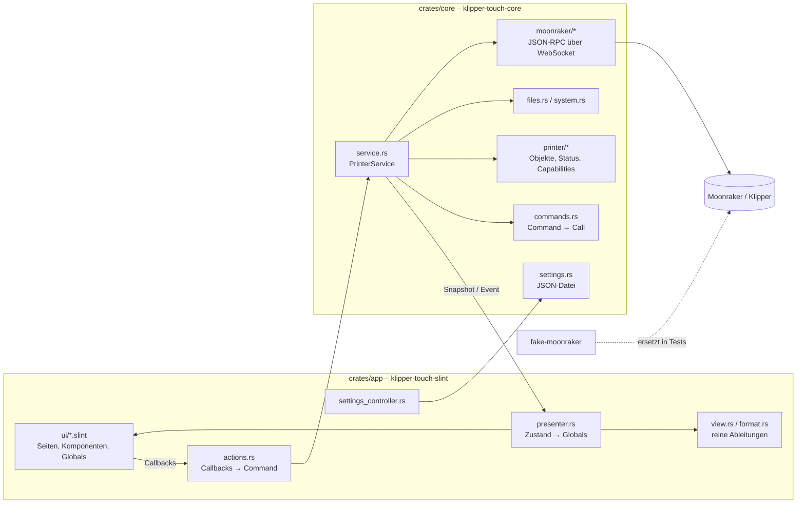

# Architektur

Ziel: eine schlanke, native Touch-Oberfläche für Klipper, die direkt am Drucker-Host läuft. Die Bedienabläufe des Menschen
bestimmen die Oberfläche (siehe `docs/UseCases and Dependencies.drawio`, Seite "Workflows"); die Fähigkeiten des Druckers
entscheiden nur, ob ein Schritt angeboten wird.

## Bausteine

| Crate | Aufgabe | Abhängig von |
|---|---|---|
| `crates/core` | Verbindung, Protokoll, Druckerzustand, Fähigkeiten, Befehle, Einstellungen. Kein UI-Code. | tokio, tokio-tungstenite, reqwest, serde |
| `crates/app` | Slint-Oberfläche und Anbindung an den Kern; Binary `klipper-touch-slint`, Werkzeug `ui-snapshot`. | core, slint |
| `crates/icon-index` | Prüft `assets/icons` und erzeugt `crates/app/ui/icons.slint` sowie `assets/icons/overview.html`. | – |
| `fake-moonraker` | Simulierter Moonraker/Klipper für Entwicklung und Tests (Profile `basic`, `voron`, `happy-hare`). | axum, tokio |

## Datenfluss

1. `PrinterService::start` startet im Tokio-Laufzeitsystem eine Schleife: verbinden, `server.connection.identify`,
   `server.info`, bei `ready` `printer.objects.list` → `Capabilities` → `printer.objects.subscribe`.
2. `notify_status_update` wird in den `ObjectStore` gemischt; `PrinterStatus::from_store` liefert die typisierte Sicht.
   Jeder neue Stand geht als `Snapshot` über einen `watch`-Kanal an die UI.
3. Einmalige Daten (Dateien, Metadaten, Vorschaubilder, Schaltgeräte, Updates, Konsole, Fehler) kommen als `Event`.
4. Die UI ruft `Actions`-Callbacks; `actions.rs` macht daraus `Command`s. `Command::to_call` übersetzt in G-Code oder
   Moonraker-Methoden; Bewegungen werden dabei auf den Achsbereich begrenzt.
5. `presenter.rs` läuft im Slint-Ereignisloop (`slint::spawn_local`) und schreibt in die Globals `Printer` und `UiSettings`.
6. Verbindungsabbruch: Zustand `disconnected`, neuer Versuch alle 2 s; Klippy-Shutdown/-Neustart über
   `notify_klippy_*` und Abfrage von `server.info`.

## Oberfläche (`crates/app/ui`)

- `app.slint`: Fenster 800x480 (wächst mit), Statusleiste, Navigationsleiste, Seite, Überlagerungen.
- `state.slint`: Globals `Printer` (nur lesen), `UiSettings`, `Actions` (Callbacks), `Navigation`, `Confirm`, `StateIcons`.
- `components/`: `controls.slint` (IconButton, StepSelector, Card, ValueTile, ProgressBar), `overlays.slint`
  (Bestätigung, Hinweis, Bildschirmtastatur, Texteingabe), `chrome.slint` (Statusleiste, Navigation).
- `pages/`: print, move, temperature, tune, extrude, macros, console, system, settings, connection.
- Seiten lesen nur Globals und rufen nur `Actions`/`Confirm`; Logik mit Druckerbezug gehört in den Kern.
- Touch-Regeln: Bedienflächen mindestens 56 px (`Theme.touch`), Bestätigung bei Abbruch, Not-Aus, Host-Aktionen;
  Bewegen und Extrudieren sind während eines Drucks gesperrt.
- Texte englisch mit `@tr(...)`, damit Übersetzungen später ohne Codeänderung möglich sind.
- Icons: `assets/icons/<kategorie>/<kategorie>-<name>.svg`, einfarbig (`currentColor`), eingefärbt mit `colorize`.

## Darstellung auf dem Gerät

- Standard ist das winit-Backend: am Desktop als Fenster, auf dem Drucker im Vollbild unter `cage` (Kiosk-Compositor,
  `scripts/install.sh`). Renderer: FemtoVG (OpenGL ES 2.0) mit Software-Renderer als Ausweichlösung
  (`SLINT_BACKEND=winit-software`).
- Optional ohne Compositor: Cargo-Feature `linuxkms` (in Slint als experimentell markiert).
- Builds für `aarch64`, `armv7` und `x86_64` laufen in CI in einem Debian-Bookworm-Container (älteste noch gepflegte glibc).

## Erweitern

- **Neuer Befehl**: Variante in `Command` + Übersetzung in `to_call` + Test; Callback in `state.slint` (`Actions`),
  Verdrahtung in `actions.rs`, Bedienelement auf der Seite.
- **Neue Fähigkeit**: Erkennung in `Capabilities::add_object` (oder `ServerComponents`), Abo in `subscription.rs`,
  Feld in `PrinterStatus`, Property in `Printer` und Zuweisung in `presenter.rs`.
- **Neue Seite**: `pages/<name>.slint`, Eintrag in `Page`, `NavRail` und `app.slint`; Prüfen mit `ui-snapshot`.
- **Fake erweitern**: Methode in `fake-moonraker/src/session.rs`, G-Code in `gcode.rs`/`printer.rs`, Test dazu.

## Prüfen

- `cargo clippy --workspace --all-targets -- -D warnings` und `cargo test --workspace` (enthält Ende-zu-Ende-Tests des
  Dienstes gegen den Fake und die Prüfung des Icon-Sets).
- `cargo run -p klipper-touch-slint --bin ui-snapshot` gegen einen laufenden Fake rendert alle Seiten ohne Fenster als PNG.
