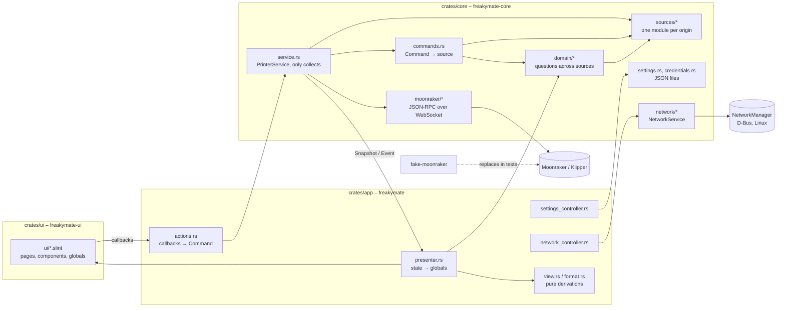

# Architecture

Goal: a lean, native touch UI for Klipper that runs directly on the printer host. The operator's workflows shape the UI
(see `docs/UseCases and Dependencies.drawio`, page "Workflows"); what the printer has only decides whether a step is
offered.

## Building blocks

| Crate                | Responsibility                                                                                    | Depends on                               |
| -------------------- | ------------------------------------------------------------------------------------------------- | ---------------------------------------- |
| `crates/core`        | Connection, the sources of the printer, questions across them, commands, settings. No UI code.    | tokio, tokio-tungstenite, reqwest, serde |
| `crates/ui`          | Slint UI (`ui/*.slint`) compiled to Rust. Kept free of the core, so core changes do not recompile it. | slint                                    |
| `crates/app`         | Binding of the UI to the core; binary `freakymate` (the only shipped program).                    | core, ui, slint                          |
| `crates/ui-snapshot` | Development tool: renders the UI headless to PNG against a running (fake) Moonraker, in scenes.   | app, core                                |
| `crates/icon-index`  | Checks `assets/icons` and generates `crates/ui/ui/icons.slint` and `assets/icons/overview.html`. | –                                        |
| `fake-moonraker`     | Simulated Moonraker/Klipper for development and tests (profiles `basic`, `voron`, `happy-hare`, `ercf`).  | axum, tokio                              |

## Core layers (`crates/core/src`)

Each layer only uses the ones before it. The program is one binary: the modules only structure the source code,
nothing is loaded at runtime or can be switched off. What is detected is used.

| Layer       | Folder                                  | What it does                                                                     |
| ----------- | --------------------------------------- | -------------------------------------------------------------------------------- |
| Transport   | `moonraker/`                            | JSON-RPC over WebSocket; knows no printer objects.                               |
| Sources     | `sources/<origin>`                      | One module per origin: detect, subscribe, read the state, know the commands.     |
| Domain      | `domain/`                               | Questions that need several sources; each answered in one place, with its order. |
| Service     | `service.rs`, `commands.rs`             | Collects, publishes `Snapshot`s and `Event`s, resolves and sends commands.       |

Sources: `klipper/` (Klipper's own objects, one module per kind: `job`, `motion`, `extruder`, `heaters`, `devices`
(fans, LEDs), `filament_sensors`, `firmware_retraction`, `exclude_object`, `leveling`, `calibration` (bed mesh, bed screws, Z height, the modes Klipper waits in, pending `SAVE_CONFIG` items); `status.rs` puts them together,
`setup.rs` detects what is there; plus configuration, macros, tuning values), `moonraker_server/` (files, job
history, power, update manager, temperature and console stores, host information, WLED strips), `happy_hare/`, `spoolman.rs`,
`led_effect.rs`, `mainsail_config.rs` (layer pause macros) and `macro_conventions.rs` (`LOAD_FILAMENT`,
`UNLOAD_FILAMENT`). `Sources` (`sources/mod.rs`) holds what was detected, each optional source as `Option` or an empty
list, its variety as data (gates, sensors, LEDs). `PrinterStatus` is the state of all printer objects, Klipper's and
those of its plugins. Happy Hare counts only while it is enabled and at least version 4.1
(`PrinterStatus::happy_hare`); every rule that depends on it asks there. Each source also knows what it is told:
Klipper's methods and G-code in `klipper/commands.rs`, Happy Hare's in `happy_hare/commands.rs`, the others beside
their reader (`led_effect.rs`, `spoolman.rs`, `moonraker_server/power.rs`, `machine.rs`, `update_manager.rs`,
`wled.rs`). G-code
of every source reaches Klipper through `klipper::commands::run_gcode`.

Domain: `filament.rs` (what Load and Unload run, which filament sensors belong to the printer), `pause.rs` (what is
known about a pause, planning a pause at a layer), `spools.rs` (lanes, hints before a print), `estimates.rs` (print
time, weight, layers, flow; measured before estimated, see `sourced.rs`), `file_catalog.rs` (the file list joined
with metadata, last completed print and its spool), `job_end.rs` (when the job Klipper shows ended, from the job
history).

## Data flow

1. `PrinterService::start` runs a loop on the Tokio runtime: connect, `server.connection.identify`, `server.info`, and
   once `ready` `printer.objects.list` → `Sources::detect` → `printer.objects.subscribe` with the objects every source
   adds (`Sources::subscription`). The parameters of the macros are read once from `configfile.settings` at that point
   (`Sources::apply_settings`); the configuration only changes with a restart, which subscribes again.
2. `notify_status_update` is merged into the `ObjectStore`; `PrinterStatus::from_store` provides the typed view
   (heaters, motion, job, objects to exclude, and Happy Hare in `sources/happy_hare/`: gates, sensors, buffer,
   FlowGuard). Moonraker's WLED strips join the LEDs as `wled <strip>`: read when subscribing, every 5 s (Moonraker
   does not report changes) and from the answer of each command to a strip; `domain/light.rs` picks the main light
   among all of them. Two pieces of state live in the service beside the store: heater targets sent but not yet
   reported back (`PendingTargets`) and what each fan's tachometer has measured since Klipper started (`FanWatch`:
   the lowest speed with a settled reading; a fan that reports 0 rpm for 5 s at or above it counts as stalled, judged
   with each status update).
   Every new state goes to the UI as a `Snapshot` (status and sources) through a `watch` channel.
3. One-off data (files, metadata, thumbnails, power devices, updates, console, errors) arrives as `Event`. File
   details are fetched four at a time, and thumbnails arrive decoded (`files::ThumbnailImage`), so the UI thread only
   copies pixels. The temperature history comes from Moonraker's `server.temperature_store` when a chart opens
   (drawn by `app/src/chart.rs` and `history_view.rs`). Spoolman is read through Moonraker's proxy: its state and the
   spools of the gates every minute and when Moonraker reports a change; the picker list on demand. The lanes
   (`domain::spools::lanes`: a gate each while Happy Hare has the say, otherwise the one active spool) are what the
   screens and the hints before a print are built from.
4. The UI calls `Actions` callbacks; `actions.rs` turns them into `Command`s. Intents such as `Level`, `ApplyPreset` or
   `LoadFilament` are resolved by `Command::resolve` into what this printer needs; `Command::to_call` hands the
   result to the source that carries it out, which builds the G-code or Moonraker call; moves are clamped to the
   axis range. Heater targets that were sent but not
   yet reported back are kept by the service and shown in the next `Snapshot`. Commands go onto the wire in the order they were
   sent (`Connection::start_call`); only the replies are awaited concurrently. A task per command would let two taps
   overtake each other, and a heater target is absolute.
5. `presenter.rs` runs in the Slint event loop (`slint::spawn_local`) and writes the globals `Printer` and `UiSettings`.
   The rows of the Slint models come from `items.rs`; lists are updated with `items::replace_rows`, which changes
   rows in place, so a tap on a button in a row survives the next status update.
6. Connection loss: state `disconnected`, retry every 2 s; Klippy shutdown/restart via `notify_klippy_*` and
   `server.info` polling.
7. Authorization (`moonraker/access.rs`, `credentials.rs`): everything runs over the WebSocket, Moonraker offers its
   `/access/*` endpoints as JSON-RPC methods too. `identify` carries the stored API key, or an access token from
   `access.refresh_jwt` with the stored refresh token. Refused (Moonraker's 401 arrives as RPC code -32602) means
   state `login-required`: the session stays open, commands fail, and `PrinterService::log_in` calls `access.login`
   on the same connection, which authorizes it; only the refresh token is stored. A key that Moonraker refuses where it
   trusts the machine anyway is dropped for that connection. An authorized connection asks `server.info` every 30 s,
   because Moonraker sends nothing to a connection whose user logged out elsewhere, not even the logout. Thumbnails
   over HTTP get a one-time token (`access.oneshot_token`, `?token=`). The credentials stay in
   `~/.config/freakymate/credentials.json` (mode 0600) also when the settings lie in `printer_data/config`, which
   Moonraker serves and which is often backed up to git.
8. Network: `NetworkService` (own task, `NetworkCommand` in, `NetworkState`/`NetworkNotice` out) uses the backend
   `networkmanager.rs` (zbus, only compiled on Linux) or `simulated.rs` (feature `dev-mode`: `--simulate-network`, tests). The
   `NetworkController` only offers management when the backend is available **and** Moonraker is local
   (`Endpoint::is_local`); otherwise it shows the host interfaces from `machine.system_info` read-only.

## UI (`crates/ui/ui`)

- `app.slint`: window 800x480 (grows with the screen), status bar, navigation rail, page, overlays.
- `state.slint`: globals `Printer` (read-only), `UiSettings`, `Actions` (callbacks), `Navigation`, `Confirm`, `StateIcons`.
- `components/`: `controls.slint` (IconButton, StepSelector, Card, ValueTile, ProgressBar, ScrollList, TouchSlider), `overlays.slint`
  (confirmation, messages flyout, on-screen keyboard, text input), `chrome.slint` (status bar with what is running and the newest
  message, navigation). Messages (errors and informations) are kept in `status_log.rs`, pure logic that the presenter shows.
- `pages/`: print, move, temperature, tune, filament (with Happy Hare the tabs MMU in `mmu.slint` with the dialogs in `mmu-dialogs.slint`, Extruder, and Service in `mmu-service.slint`; otherwise the extruder alone), console (with the macro list), system, settings, connection.
- Pages only read globals and only call `Actions`/`Confirm`; printer-related logic belongs in the core.
- Touch rules: controls at least 56 px (`Theme.touch`), confirmation for cancel, emergency stop and host actions;
  moving and extruding are locked while printing.
- No scrolling except for lists of any length (files, macros, console, networks): `ScrollList` with a slim bar that
  can be dragged or tapped. Coarse values such as the fan speed use `TouchSlider`. One list per kind of item.
- Texts in English with `@tr(...)`, so translations can be added later without code changes.
- Icons: `assets/icons/<category>/<category>-<name>.svg`, single colour (`currentColor`), tinted with `colorize`.

## Display on the device

- Default is the winit backend: a window on the desktop, fullscreen under `cage` on the printer (kiosk compositor,
  `scripts/install.sh`). `cage -d` hands the frame to the server, which draws none; without it winit keeps room for
  its own title bar after leaving fullscreen (black bar at the bottom). Renderer: FemtoVG (OpenGL ES 2.0) with the software renderer as fallback
  (`SLINT_BACKEND=winit-software`).
- The layout is made for 800x480. `display.rs` scales the window so that this size just fits into the real one
  (`min(width / 800, height / 480)`); the window is then as large as the design size on one axis and larger on the
  other. The scale of the system is not used, and `SLINT_SCALE_FACTOR` switches the fitting off. Fitting and the
  hidden pointer in fullscreen share one winit event filter (`app::watch_window_events`): Slint keeps only one per
  window. Responsive layouts for
  7" and 4.3" displays are planned.
- Optional without compositor: cargo feature `linuxkms` (marked experimental in Slint).
- Builds for `aarch64`, `armv7` and `x86_64` run in CI in a Debian Bookworm container (oldest still maintained glibc).

## Extending

- **New command**: variant in `Command`, its G-code or call in the module of its source (with a test) and one line
  in `to_call` that hands it there (or, if what the printer has decides what it means, an intent resolved in
  `Command::resolve`); callback in `state.slint` (`Actions`),
  wiring in `actions.rs`, control on the page.
- **New source** (a plugin, a Moonraker component, a macro convention): its own module in `sources/` with detection
  (a field in `Sources`, `Option` or a list), its objects in `Sources::subscription`, its reader and tests; property
  in `Printer` and assignment in `presenter.rs`. An existing source grows inside its module.
- **New question across sources** or **derived value** (e.g. a measurement and a slicer estimate): one function in
  `domain/`, which decides the order of the sources, returns a `Sourced` value where it names its source, and gets a
  test per source. `view.rs` only formats it (a prediction gets a `~`).
- **New page**: `pages/<name>.slint`, entry in `Page`, `NavRail` and `app.slint`; check with `ui-snapshot`.
- **Extend the fake**: method in `fake-moonraker/src/session.rs`, G-code in `gcode.rs`/`printer.rs`, plus a test.

## Checks

- `cargo clippy --workspace --all-targets -- -D warnings` and `cargo test --workspace` (includes end-to-end tests of the
  service against the fake and the icon set check).
- `scripts/ui-preview.sh [-n temperature]` (WSL2/Arch) or `powershell -File scripts\ui-preview.ps1 [-Name temperature]`
  (Windows) renders the previews in `crates/ui/ui/preview`
  with `slint-viewer` in under a second each, without building Rust code. A preview is a small component that
  inherits `AppWindow` and fills the globals with sample data (`preview/sample.slint`); the same files open in the
  Slint live preview of VS Code. The app never imports this folder. Fastest way to check layouts; keep the sample
  data in line when globals change (the script fails on compile errors).
- `scripts/ui-snapshot.sh` (WSL2/Arch) or `powershell -File scripts\ui-snapshot.ps1` (Windows), or `cargo run -p ui-snapshot`
  against a running fake, renders the pages
  as PNG without a window. Scenes: `pages`, `network`, `printing`, `shutdown`, `idle` (slow, only with `-Scenes idle|all`).

## Development mode

Cargo feature `dev-mode` (default of `crates/app`, passed on to `crates/core`) bundles everything that is only meant
for development: today the simulated networks and the option `--simulate-network`. Release builds use
`--no-default-features`; CI runs Clippy for that configuration too. `cargo test --workspace` includes `dev-mode`
because `crates/ui-snapshot` requires it.
