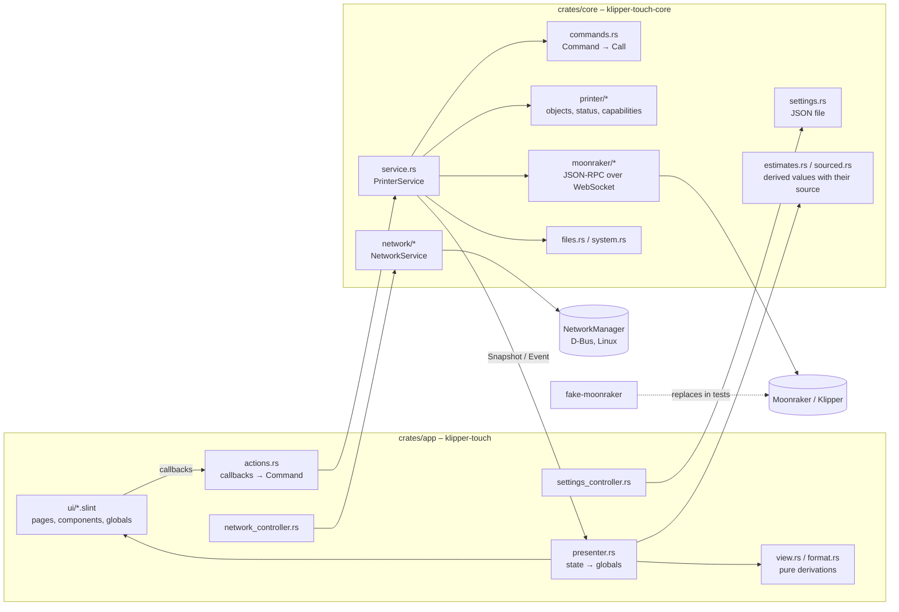

# Architecture

Goal: a lean, native touch UI for Klipper that runs directly on the printer host. The operator's workflows shape the UI
(see `docs/UseCases and Dependencies.drawio`, page "Workflows"); the printer's capabilities only decide whether a step is
offered.

## Building blocks

| Crate                | Responsibility                                                                                    | Depends on                               |
| -------------------- | ------------------------------------------------------------------------------------------------- | ---------------------------------------- |
| `crates/core`        | Connection, protocol, printer state, capabilities, commands, settings. No UI code.                | tokio, tokio-tungstenite, reqwest, serde |
| `crates/app`         | Slint UI and its binding to the core; binary `klipper-touch` (the only shipped program).          | core, slint                              |
| `crates/ui-snapshot` | Development tool: renders the UI headless to PNG against a running (fake) Moonraker, in scenes.   | app, core                                |
| `crates/icon-index`  | Checks `assets/icons` and generates `crates/app/ui/icons.slint` and `assets/icons/overview.html`. | –                                        |
| `fake-moonraker`     | Simulated Moonraker/Klipper for development and tests (profiles `basic`, `voron`, `happy-hare`).  | axum, tokio                              |

## Data flow

1. `PrinterService::start` runs a loop on the Tokio runtime: connect, `server.connection.identify`, `server.info`, and
   once `ready` `printer.objects.list` → `Capabilities` → `printer.objects.subscribe`.
2. `notify_status_update` is merged into the `ObjectStore`; `PrinterStatus::from_store` provides the typed view
   (heaters, motion, job, macros, objects to exclude, and Happy Hare in `printer/mmu.rs`: gates, sensors, buffer, FlowGuard).
   `Capabilities::filament_handling` decides where Load and Unload come from: Happy Hare, else the macros
   `LOAD_FILAMENT`/`UNLOAD_FILAMENT`, else nothing.
   Every new state goes to the UI as a `Snapshot` through a `watch` channel.
3. One-off data (files, metadata, thumbnails, power devices, updates, console, errors) arrives as `Event`. Spoolman
   (`spoolman.rs`) is read through Moonraker's proxy: its state and the spools of the gates every minute and when
   Moonraker reports a change; the picker list on demand. The `lanes` (a gate each with MMU, otherwise the one active
   spool) are what the screens and the hints before a print are built from.
4. The UI calls `Actions` callbacks; `actions.rs` turns them into `Command`s. Intents such as `Level`, `ApplyPreset` or
   `LoadFilament` are resolved by `Command::resolve` into what this printer needs; `Command::to_call` translates the
   result into G-code or Moonraker methods; moves are clamped to the axis range. Heater targets that were sent but not
   yet reported back are kept by the service and shown in the next `Snapshot`. Commands go onto the wire in the order they were
   sent (`Connection::start_call`); only the replies are awaited concurrently. A task per command would let two taps
   overtake each other, and a heater target is absolute.
5. `presenter.rs` runs in the Slint event loop (`slint::spawn_local`) and writes the globals `Printer` and `UiSettings`.
6. Connection loss: state `disconnected`, retry every 2 s; Klippy shutdown/restart via `notify_klippy_*` and
   `server.info` polling.
7. Network: `NetworkService` (own task, `NetworkCommand` in, `NetworkState`/`NetworkNotice` out) uses the backend
   `networkmanager.rs` (zbus, only compiled on Linux) or `simulated.rs` (feature `dev-mode`: `--simulate-network`, tests). The
   `NetworkController` only offers management when the backend is available **and** Moonraker is local
   (`Endpoint::is_local`); otherwise it shows the host interfaces from `machine.system_info` read-only.

## UI (`crates/app/ui`)

- `app.slint`: window 800x480 (grows with the screen), status bar, navigation rail, page, overlays.
- `state.slint`: globals `Printer` (read-only), `UiSettings`, `Actions` (callbacks), `Navigation`, `Confirm`, `StateIcons`.
- `components/`: `controls.slint` (IconButton, StepSelector, Card, ValueTile, ProgressBar, ScrollList, TouchSlider), `overlays.slint`
  (confirmation, messages flyout, on-screen keyboard, text input), `chrome.slint` (status bar with the newest message,
  navigation). Messages (errors and informations) are kept in `status_log.rs`, pure logic that the presenter shows.
- `pages/`: print, move, temperature, tune, filament (extruder tab and, with Happy Hare, the MMU tab in `mmu.slint`), console (with the macro list), system, settings, connection.
- Pages only read globals and only call `Actions`/`Confirm`; printer-related logic belongs in the core.
- Touch rules: controls at least 56 px (`Theme.touch`), confirmation for cancel, emergency stop and host actions;
  moving and extruding are locked while printing.
- No scrolling except for lists of any length (files, macros, console, networks): `ScrollList` with a slim bar that
  can be dragged or tapped. Coarse values such as the fan speed use `TouchSlider`. One list per kind of item.
- Texts in English with `@tr(...)`, so translations can be added later without code changes.
- Icons: `assets/icons/<category>/<category>-<name>.svg`, single colour (`currentColor`), tinted with `colorize`.

## Display on the device

- Default is the winit backend: a window on the desktop, fullscreen under `cage` on the printer (kiosk compositor,
  `scripts/install.sh`). Renderer: FemtoVG (OpenGL ES 2.0) with the software renderer as fallback
  (`SLINT_BACKEND=winit-software`).
- The layout is made for 800x480. `display.rs` scales the window so that this size just fits into the real one
  (`min(width / 800, height / 480)`); the window is then as large as the design size on one axis and larger on the
  other. The scale of the system is not used, and `SLINT_SCALE_FACTOR` switches the fitting off. Responsive layouts for
  7" and 4.3" displays are planned.
- Optional without compositor: cargo feature `linuxkms` (marked experimental in Slint).
- Builds for `aarch64`, `armv7` and `x86_64` run in CI in a Debian Bookworm container (oldest still maintained glibc).

## Extending

- **New command**: variant in `Command` + translation in `to_call` (or, if the printer's capabilities decide what it
  means, an intent resolved in `Command::resolve`) + test; callback in `state.slint` (`Actions`),
  wiring in `actions.rs`, control on the page.
- **New capability**: detection in `Capabilities::add_object` (or `ServerComponents`), subscription in `subscription.rs`,
  field in `PrinterStatus`, property in `Printer` and assignment in `presenter.rs`.
- **New derived value** (from several sources, e.g. a measurement and a slicer estimate): the rule goes into the core
  (`estimates.rs`, or next to the status reader), returns a `Sourced` value that names its source, and gets a test per
  source. `view.rs` only formats it (a prediction gets a `~`).
- **New page**: `pages/<name>.slint`, entry in `Page`, `NavRail` and `app.slint`; check with `ui-snapshot`.
- **Extend the fake**: method in `fake-moonraker/src/session.rs`, G-code in `gcode.rs`/`printer.rs`, plus a test.

## Checks

- `cargo clippy --workspace --all-targets -- -D warnings` and `cargo test --workspace` (includes end-to-end tests of the
  service against the fake and the icon set check).
- `scripts/ui-preview.sh [-n temperature]` (WSL2/Arch) or `powershell -File scripts\ui-preview.ps1 [-Name temperature]`
  (Windows) renders the previews in `crates/app/ui/preview`
  with `slint-viewer` in under a second each, without building Rust code. A preview is a small component that
  inherits `AppWindow` and fills the globals with sample data (`preview/sample.slint`); the same files open in the
  Slint live preview of VS Code. The app never imports this folder. Fastest way to check layouts; keep the sample
  data in line when globals change (the script fails on compile errors).
- `scripts/ui-snapshot.sh` (WSL2/Arch) or `powershell -File scripts\ui-snapshot.ps1` (Windows), or `cargo run -p ui-snapshot`
  against a running fake, renders the pages
  as PNG without a window. Scenes: `pages`, `network`, `printing`, `shutdown`, `idle` (slow, only with `-Scenes idle|all`).

## Development mode

Cargo feature `dev-mode` (default of `crates/app`, passed on to `crates/core`) bundles everything that is only meant
for development: today the simulated networks and the option `--simulate-network`. Release builds use
`--no-default-features`; CI runs Clippy for that configuration too. `cargo test --workspace` includes `dev-mode`
because `crates/ui-snapshot` requires it.
